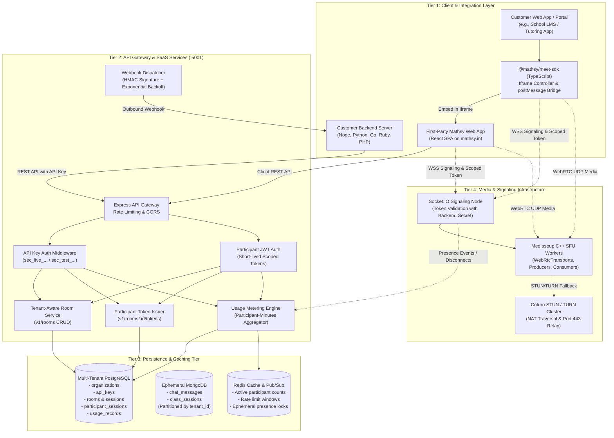

# Mathsy Meet SaaS — Target Architecture Specification

**Document:** `docs/saas/architecture.md`  
**Date:** October 2026  
**Status:** Architecture Proposal & System Design

---

## 1. System Vision

The Mathsy Meet SaaS platform transforms the single-tenant virtual classroom into a managed, multi-tenant video infrastructure platform. Third-party B2B customers (schools, EdTech companies, tutoring agencies, telehealth providers) can programmatically create rooms via REST API, mint cryptographically signed participant tokens, embed interactive video meetings into their web applications via a TypeScript SDK, receive real-time webhook events, and manage usage via a developer dashboard.

---

## 2. Target 4-Tier Architecture Diagram

---

## 3. Tier Responsibilities

### Tier 1: Client & Integration Layer
- **First-Party App (`src/`):** Continues serving standalone users at `meet.mathsy.in` with backward-compatible first-party organization mapping.
- **Embedded Route (`/embed/:roomCode`):** Ultra-minimal, frameless UI designed specifically for iframe embedding.
- **Client SDK (`@mathsy/meet-sdk/client`):** Lightweight TypeScript wrapper managing iframe creation, origin validation, event bubbling (`ready`, `join`, `leave`, `mic_change`), and UI command execution (`mute()`, `unmute()`, `leave()`).
- **Server SDK (`@mathsy/meet-sdk/server`):** Node.js/TypeScript helper for room creation and participant token minting.

### Tier 2: SaaS API Gateway & Application Services
- **API Key Engine:** Authenticates backend server-to-server requests using high-entropy keys (`sec_live_...` or `sec_test_...`).
- **Participant Token Engine:** Mints short-lived (1–4 hour) JWTs encoding `tenant_id`, `room_id`, `user_id`, `role`, and permitted features.
- **Tenant Room Service:** Enforces that all CRUD operations on rooms, sessions, and participants are strictly scoped to the caller's `tenant_id`.
- **Webhook Dispatcher:** Dispatches reliable HTTP callbacks to customer endpoints for room lifecycle events (`room.created`, `room.ended`, `participant.joined`, `participant.left`) signed with HMAC-SHA256.
- **Usage Metering Engine:** Records exact session intervals and aggregates billable participant-minutes.

### Tier 3: Persistence & Caching Tier
- **PostgreSQL:** Authoritative relational store. Stores organizations, API keys, rooms, historical attendance sessions, usage aggregates, and billing records.
- **MongoDB:** Ephemeral in-class chat store. Partitioned strictly by `tenant_id` and `sessionId`, auto-purged on class end.
- **Redis (Proposed):** Fast in-memory state for rate-limiting, distributed locks, and real-time active participant counts.

### Tier 4: Media & Signaling Infrastructure
- **Socket.IO Signaling Nodes:** Terminate WebSocket connections. Must validate participant tokens signed by the SaaS backend before accepting socket entry.
- **Mediasoup SFU Routers:** Route audio, video, and screen sharing RTP streams across WebRtcTransports.
- **Coturn STUN/TURN:** Provides NAT traversal and TLS relay for restricted corporate or institutional firewalls.

---

## 4. Dependency Map: Impact on Existing Modules

| Proposed SaaS Feature | Affected Existing Modules | Scope of Modification |
|---|---|---|
| **Tenant Scoping & Multi-Tenancy** | [server/routes/rooms.ts](file:///Users/adityachavhan/Documents/Mathsy/mathsy-meet/server/routes/rooms.ts) [server/routes/chat.ts](file:///Users/adityachavhan/Documents/Mathsy/mathsy-meet/server/routes/chat.ts) [server/routes/polls.ts](file:///Users/adityachavhan/Documents/Mathsy/mathsy-meet/server/routes/polls.ts) | Add `tenant_id` column to SQL queries; attach `req.tenant` in middleware. |
| **API Key Authentication** | [server/routes/auth.ts](file:///Users/adityachavhan/Documents/Mathsy/mathsy-meet/server/routes/auth.ts) New: `server/middleware/apiKeyAuth.ts` | New middleware validating `Authorization: Bearer sec_...`; hash comparison. |
| **Participant Token Issuance** | [server/routes/auth.ts](file:///Users/adityachavhan/Documents/Mathsy/mathsy-meet/server/routes/auth.ts) New: `server/routes/v1/tokens.ts` | Mint JWT containing `tenant_id`, `room_code`, `role`, and `permissions`. |
| **Iframe Embed Route** | [src/App.tsx](file:///Users/adityachavhan/Documents/Mathsy/mathsy-meet/src/App.tsx) New: `src/components/embed/EmbedRoomView.tsx` | Add `/embed/:roomCode` route; disable headers/navigation; enable `postMessage`. |
| **Speaking Request Protocol** | [src/components/meet/MeetingRoom.tsx](file:///Users/adityachavhan/Documents/Mathsy/mathsy-meet/src/components/meet/MeetingRoom.tsx) [src/engine/mediasoupClient.ts](file:///Users/adityachavhan/Documents/Mathsy/mathsy-meet/src/engine/mediasoupClient.ts) | Preserve working speaking request state machine; bubble events to parent iframe. |
| **Signaling Authorization** | External `rtc.mathsy.in` / New SFU gateway | Verify JWT `aud` and `room_code` claims on `connection` handshake. |
| **Usage Metering & Webhooks** | [server/routes/rooms.ts](file:///Users/adityachavhan/Documents/Mathsy/mathsy-meet/server/routes/rooms.ts) New: `server/services/metering.ts` | Emit usage event on `participant.join` and `participant.leave`. |

---

## 5. Backward Compatibility Strategy

To ensure zero downtime or disruption to current Mathsy Meet classes:
1. **System Default Tenant:** A dedicated system tenant (`00000000-0000-0000-0000-000000000000`, named `"Mathsy Classroom (First-Party)"`) will own all existing rows in `live_classes` and `users`.
2. **Dual-Mode Auth Middleware:**
   - Existing web frontend calls passing Google OAuth JWT continue authenticating via `requireAuth` assigned to the default tenant.
   - External B2B API calls authenticate via `apiKeyAuth` assigned to their respective customer organization.
3. **Route Preservation:** Existing `/meet/:roomCode` URLs and REST endpoints (`/api/rooms/*`) remain 100% active, while versioned B2B API routes are introduced under `/v1/*`.
