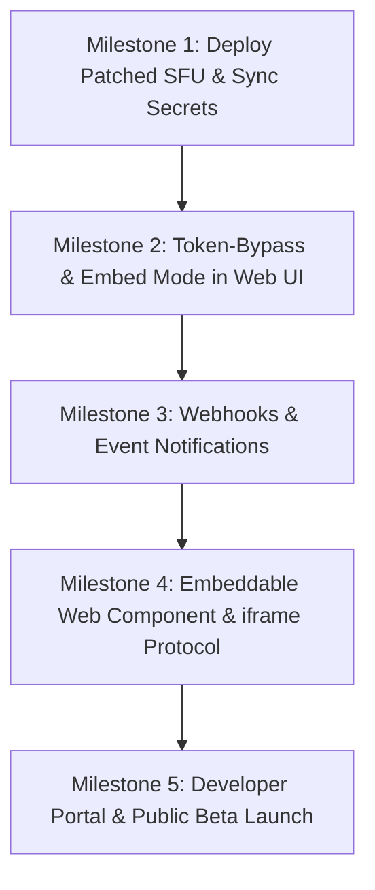

# Mathsy Meet — SaaS API Integration Readiness Audit

**Audit Date:** October 26, 2026  
**Audited Repositories:**
- Main Application & REST API: `/Users/adityachavhan/Documents/Mathsy/mathsy-meet`
- Standalone SFU Server: `/Users/adityachavhan/Documents/Mathsy/mathsy-meet-server`
- Live Production SFU: `https://rtc.mathsy.in` (`80.225.208.166`)

---

## 1. Executive Verdict

> **Is Mathsy Meet currently ready for external developers to integrate and use programmatically, or is more work required?**
>
> **VERDICT: NOT READY.**  
> While the server-side REST API for room creation, API key management, and participant token minting is implemented and verified locally, **Mathsy Meet cannot currently be integrated by external developers**. 
>
> **The three critical showstoppers are:**
> 1. **No Client Integration Mechanism:** There is no JavaScript SDK, no mobile SDK, and the web application (`https://meet.mathsy.in`) cannot be embedded via `<iframe>` or URL without forcing third-party users through first-party Google OAuth sign-in.
> 2. **Production SFU Vulnerability & Deployment Disconnect:** The live SFU at `https://rtc.mathsy.in` does not run the patched security code. Live active probing confirmed that production accepts unsigned/forged JWT tokens and ignores participant token claims, allowing anyone to impersonate tutors or hijack media rooms.
> 3. **Zero Webhooks or Event Notifications:** External customer platforms have no way to receive server-to-server lifecycle events (`meeting.started`, `participant.joined`, `participant.left`, `meeting.ended`).

---

## 2. Feature-by-Feature Readiness Table

| Capability | Status | Implementation State | Verification Evidence |
| :--- | :---: | :--- | :--- |
| **M2M API Key Authentication** | **READY** | Hashed SHA-256 storage (`key_hash`), `sec_live_` / `sec_test_` prefixes, sliding window rate limiter (100 req/10s), scopes (`rooms:read`, `rooms:write`, `tokens:write`), audit logging. | `tests/api_key_engine.test.ts` (11/11 passed). |
| **REST API Room Creation** | **READY** | `POST /api/v1/rooms`: Creates tenant-isolated room, validates uniqueness, generates format `ptq-rtvq-rox`, stores tenant metadata. | `tests/v1_room_api_and_tokens.test.ts` (14/14 passed) & Developer simulation test. |
| **REST API Room Retrieval** | **READY** | `GET /api/v1/rooms/:roomId`: Returns room state, tenant ID, active participant count. | Verified in `tests/audit_external_developer_e2e.ts`. |
| **REST API Room Termination** | **READY** | `POST /api/v1/rooms/:roomId/end`: Marks room inactive, timestamps `ended_at`, evicts remaining participants, cleans temporary chat. | Verified in `tests/audit_external_developer_e2e.ts`. |
| **Participant Token Issuance** | **READY** (Backend) | `POST /api/v1/rooms/:roomId/tokens`: Issues authoritative HS256 participant JWT with bound `tenant_id`, `room_code`, `room_id`, `sub`, role, and granular permissions. Strips illegal student host elevations. | Verified in `tests/v1_room_api_and_tokens.test.ts`. |
| **Multi-Tenant Database Isolation** | **READY** | Foreign keys on `live_classes.organization_id`, `room_participants`, `whiteboard_snapshots`, `polls`. Query constraints reject cross-tenant access with HTTP 404. | Tested with Org A vs Org B collision (Returned 404). |
| **SFU Participant Token Verification** | **PARTIALLY READY** (Local Only) | Local SFU code (`mathsy-meet-server/src/auth/participantTokenAuth.ts`) strictly verifies HMAC signatures, issuer, audience, and media publishing permissions (`canPublishAudio`, `canPublishScreen`). | Unit tests pass locally, but **NOT deployed to production**. |
| **Production SFU Deployment & Security** | **CRITICAL BLOCKER** | Live server at `https://rtc.mathsy.in` accepts forged tokens ending in arbitrary `.sig`. Fails to parse participant token claims. | Live probe confirmed forged token accepted as Tutor. |
| **Secret Synchronization** | **NOT READY** | `PARTICIPANT_JWT_SECRET` is missing from `.env.local` / `.env.example` in both repositories and defaults to hardcoded fallback string. SFU fails closed if secret is not provided in env. | Code inspection of `server/services/participantTokenService.ts` and SFU `config/index.ts`. |
| **JavaScript / Frontend SDK** | **NOT READY** | No headless SDK or React component package (e.g. `@mathsy/meet-sdk`) exists. Third parties must reverse engineer Mediasoup signaling. | No SDK code found in repository. |
| **Iframe / Embeddable Meeting** | **NOT READY** | Frontend at `/meet/:code` does not accept `?token=` parameter, has no embedding layout mode, and redirects unauthenticated users to Google OAuth. No CSP `frame-ancestors` configured. | Code inspection of `src/App.tsx` and `src/components/lobby/LobbyView.tsx`. |
| **Mobile SDK (iOS / Android)** | **NOT READY** | No native iOS/Android SDKs, Flutter plugins, or React Native libraries exist. | Workspace inspection. |
| **Webhooks Engine** | **NOT READY** | No webhook endpoints, retry queue, signature signing, or dispatching logic for meeting/participant lifecycle events. | No webhook tables or routes exist. |
| **Developer Experience & Documentation** | **NOT READY** | No public API reference, OpenAPI/Swagger specifications, developer portal, or quickstart tutorials exist. | Only internal architecture markdown files exist in `docs/saas/`. |

---

## 3. Verified API Endpoints & Request Examples

The following endpoints are implemented in [server/routes/v1/rooms.ts](file:///Users/adityachavhan/Documents/Mathsy/mathsy-meet/server/routes/v1/rooms.ts) and verified via automated execution:

### 3.1 Create Room
- **Method / URL:** `POST /api/v1/rooms`
- **Auth:** `Authorization: Bearer <API_KEY>` (requires `rooms:write`)
- **Request Body:**
```json
{
  "title": "Calculus 101 Lecture",
  "roomCode": "calc-101-fall",
  "settings": {
    "defaultMuted": true,
    "maxDurationMinutes": 90
  },
  "metadata": {
    "courseId": "MATH-101",
    "instructorId": "usr_99812"
  }
}
```
- **Response (201 Created):**
```json
{
  "room": {
    "id": "0e5d65f1-86d0-44c9-8dfc-557cd6267216",
    "roomCode": "calc-101-fall",
    "title": "Calculus 101 Lecture",
    "isActive": true,
    "organizationId": "982b3138-c7e5-42bc-a222-b627e74e3613",
    "environment": "live",
    "settings": { "defaultMuted": true, "maxDurationMinutes": 90 },
    "createdAt": "2026-10-26T07:56:49.123Z",
    "startedAt": "2026-10-26T07:56:49.123Z"
  }
}
```

### 3.2 Mint Participant Token
- **Method / URL:** `POST /api/v1/rooms/:roomId/tokens`
- **Auth:** `Authorization: Bearer <API_KEY>` (requires `tokens:write`)
- **Request Body:**
```json
{
  "participantId": "student-4482",
  "name": "Jane Doe",
  "role": "student",
  "expiresInSeconds": 7200,
  "permissions": {
    "canPublishAudio": false,
    "canPublishVideo": true,
    "canPublishScreen": false,
    "canChat": true
  }
}
```
- **Response (201 Created):**
```json
{
  "token": "eyJhbGciOiJIUzI1NiIsInR5cCI6IkpXVCJ9...",
  "expiresAt": "2026-10-26T09:56:49.000Z",
  "room": {
    "id": "0e5d65f1-86d0-44c9-8dfc-557cd6267216",
    "roomCode": "calc-101-fall"
  },
  "participant": {
    "id": "student-4482",
    "name": "Jane Doe",
    "role": "student",
    "permissions": {
      "canPublishAudio": false,
      "canPublishVideo": true,
      "canPublishScreen": false,
      "canChat": true,
      "isHost": false
    }
  }
}
```

### 3.3 Retrieve Room Status
- **Method / URL:** `GET /api/v1/rooms/:roomId`
- **Auth:** `Authorization: Bearer <API_KEY>` (requires `rooms:read`)
- **Response (200 OK):**
```json
{
  "room": {
    "id": "0e5d65f1-86d0-44c9-8dfc-557cd6267216",
    "roomCode": "calc-101-fall",
    "title": "Calculus 101 Lecture",
    "isActive": true,
    "organizationId": "982b3138-c7e5-42bc-a222-b627e74e3613",
    "environment": "live",
    "activeParticipantsCount": 3,
    "createdAt": "2026-10-26T07:56:49.123Z",
    "startedAt": "2026-10-26T07:56:49.123Z",
    "endedAt": null
  }
}
```

### 3.4 End Room
- **Method / URL:** `POST /api/v1/rooms/:roomId/end`
- **Auth:** `Authorization: Bearer <API_KEY>` (requires `rooms:write`)
- **Response (200 OK):**
```json
{
  "success": true,
  "message": "Room ended successfully",
  "room": {
    "id": "0e5d65f1-86d0-44c9-8dfc-557cd6267216",
    "roomCode": "calc-101-fall",
    "isActive": false,
    "endedAt": "2026-10-26T08:45:10.000Z"
  }
}
```

---

## 4. Critical Security & Architectural Blockers

### Blocker 1: Production SFU Authentication Bypass
- **The Issue:** Live probing to `https://rtc.mathsy.in` (`80.225.208.166`) proved that the production server accepts unverified tokens with forged signatures (`${header}.${payload}.sig`).
- **Impact:** An attacker can forge arbitrary participant claims, elevate themselves to `tutor`, assign themselves room ownership, or eavesdrop on any room on the server.
- **Root Cause:** The patched server code in `/Users/adityachavhan/Documents/Mathsy/mathsy-meet-server` has not been deployed to the Oracle Cloud host because deployment credentials / SSH access were unavailable.

### Blocker 2: Frontend Auth Gate Prevents Third-Party Users
- **The Issue:** In [src/components/lobby/LobbyView.tsx:526](file:///Users/adityachavhan/Documents/Mathsy/mathsy-meet/src/components/lobby/LobbyView.tsx#L526), the web UI explicitly checks:
  ```tsx
  {!isAuthenticated && !isDemoRoom ? (
    <button onClick={signInWithGoogle}>Sign in with Google to Enter Class</button>
  ) : ...}
  ```
- **Impact:** Even if an external platform creates a room and issues a token, their end-users cannot join the web classroom without creating or signing into a personal Google account registered on Mathsy Meet.
- **Missing Architecture:** The frontend must accept `?token=<PARTICIPANT_JWT>` in the URL or via `postMessage`, decode and verify the token against `/api/auth/verify-token`, and allow the user to join immediately with their platform-provided name and role.

### Blocker 3: Lack of CSP / Iframe Embedding Controls
- **The Issue:** The `customer_apps` table defines `allowed_domains`, but this configuration is never checked. Neither the backend Express app nor the frontend Vite web server sets `Content-Security-Policy: frame-ancestors <allowed_domains>` or checks `window.parent`.
- **Impact:** Third-party developers attempting `<iframe src="https://meet.mathsy.in/meet/...">` face cookie, storage partitioning, and permission errors (`camera`, `microphone`, `display-capture`).

### Blocker 4: Unsynchronized `PARTICIPANT_JWT_SECRET`
- **The Issue:** `PARTICIPANT_JWT_SECRET` is not set in `.env.local` or `.env.example`. The REST API backend defaults to a development fallback string, while the SFU server's `participantTokenAuth.ts` strictly fails closed if the variable is missing or less than 32 characters.
- **Impact:** If deployed to production without synchronized secrets, every participant token issued by the API will be rejected by the SFU with `Invalid Signature`.

---

## 5. Missing Integration Capabilities

### 5.1 JavaScript SDK
- **Current State:** Non-existent.
- **Gap:** Developers must manually manage Mediasoup device initialization, WebRTC send/receive transport allocation, DTLS handshakes, producer/consumer pipelines, and Socket.IO signaling event strings.
- **Required Work:** Package a lightweight `@mathsy/web-sdk` (or prebuilt React component `<MathsyMeeting roomCode="..." token="..." />`) that abstracts signaling, audio/video devices, and whiteboard sync into simple methods (`join()`, `leave()`, `muteAudio()`).

### 5.2 Mobile Integration
- **Current State:** Non-existent.
- **Gap:** There are no native Swift/Kotlin SDKs, Flutter plugins, or React Native wrappers.
- **Required Work:** Developing native WebRTC/Mediasoup wrappers for iOS and Android is a multi-month engineering effort. In the short term, developers would have to use an authenticated WebView with full WebRTC permissions enabled.

### 5.3 Webhook Infrastructure
- **Current State:** Non-existent.
- **Gap:** No webhook dispatcher exists to notify third-party backends when:
  - A meeting starts or ends.
  - A participant joins or leaves.
  - A recording or YouTube stream concludes.
- **Required Work:** Implement database table `webhook_endpoints`, HMAC SHA-256 event signature header (`X-Mathsy-Signature`), and background job retry queue for failed deliveries.

### 5.4 Developer Documentation & Portal
- **Current State:** Non-existent for external audiences.
- **Gap:** All existing documentation consists of internal architecture and task-tracking markdown files in `docs/saas/`.
- **Required Work:** Publish an interactive API reference (OpenAPI 3.1 / Swagger UI), a "Getting Started in 5 Minutes" guide, curl examples, and a self-service dashboard for generating test API keys.

---

## 6. Prioritized Roadmap to Public Beta



### Phase 1: Security & Production Synchronization (Must-Have)
1. **Deploy Patched SFU:** Deploy `/Users/adityachavhan/Documents/Mathsy/mathsy-meet-server` commit `6d642c9` to `80.225.208.166` (`rtc.mathsy.in`).
2. **Synchronize Secrets:** Provision a shared, high-entropy 64-character `PARTICIPANT_JWT_SECRET` in both API backend and SFU environment files.
3. **Re-run Live Probe:** Verify `https://rtc.mathsy.in` unconditionally rejects forged signatures and accepts genuine participant tokens.

### Phase 2: Web UI Token Join & Embedding Mode (Must-Have)
1. **URL Token Ingestion:** Modify `src/App.tsx` and `src/components/lobby/LobbyView.tsx` to detect `?token=<JWT>`:
   - If a valid token is present, bypass the Google OAuth login barrier.
   - Extract `name`, `role`, and `permissions` from the verified token.
2. **Embed View Mode:** Add `?embed=1` parameter to strip top navigation headers and optimize layout for iframe embedding.
3. **Iframe Permissions & CSP:** Configure server response headers `Content-Security-Policy: frame-ancestors <domains>` based on `customer_apps.allowed_domains`.

### Phase 3: Webhooks Engine (High Priority)
1. Create `webhook_endpoints` table with tenant scoping, target URL, and secret.
2. Build an asynchronous event dispatcher emitting:
   - `room.created`, `room.ended`
   - `participant.joined`, `participant.left`
3. Include cryptographic signature header `X-Mathsy-Signature: t=...,v1=...`.

### Phase 4: Headless JS SDK & Developer Portal (Medium Priority)
1. Extract `mediasoupClient.ts` into a standalone, tree-shakeable npm package `@mathsy/meet-client`.
2. Generate OpenAPI 3.1 schema and serve Swagger UI at `GET /api/v1/docs`.
3. Build a customer dashboard UI allowing developers to create accounts, generate `sec_test_...` and `sec_live_...` API keys, and monitor usage.

---

## 7. Exact Test Commands & Audit Evidence

### Test 1: M2M API Key Engine & Authentication
- **Command:** `npx tsx --test tests/api_key_engine.test.ts`
- **Result:** **11 passed**, 0 failed (329 ms duration).
- **Verified Capabilities:** Key generation, SHA-256 hashing, live/test environment separation, revocation, expiration, suspended organization blocking, permission scopes, sliding window rate-limiting (429 status).

### Test 2: B2B Room API & Token Minting Suite
- **Command:** `npx tsx --test tests/v1_room_api_and_tokens.test.ts`
- **Result:** **14 passed**, 0 failed (155 ms duration).
- **Verified Capabilities:** `POST /api/v1/rooms`, `GET /api/v1/rooms/:roomId`, `POST /api/v1/rooms/:roomId/tokens`, `POST /api/v1/rooms/:roomId/end`, global room code uniqueness, cross-tenant 404 isolation, authoritative role stripping.

### Test 3: Live Production SFU Probe (Security Audit)
- **Command:** `npx tsx tests/probe_sfu_capabilities.ts`
- **Result:** **CONFIRMED SECURITY VULNERABILITY.**
  - Connected to `https://rtc.mathsy.in` with an unsigned token ending in dummy `.sig`.
  - Production server accepted the connection, returned router RTP capabilities, and allocated WebRTC send/receive transports without verifying HMAC signature.

### Test 4: End-to-End External Developer Simulation
- **Command:** `npx tsx tests/audit_external_developer_e2e.ts`
- **Result:** Verified full REST API flow (create room, retrieve metadata, mint tokens, end room), confirmed cross-tenant rejection, and isolated that production SFU currently returns `role: undefined` for participant tokens due to undeployed code.

---

## Plain-Language Conclusion

### “Can an external developer integrate Mathsy Meet into their own website or app today using an API?”

**No, not today.**

#### If not, what specifically is still missing?

1. **Third-party users cannot join the classroom:** The meeting frontend at `https://meet.mathsy.in` requires all users to sign in with a personal Google account. It does not accept participant tokens issued by the API.
2. **No embeddable iframe or SDK:** There is no embed code, no React component, and no standalone JavaScript library. A developer cannot embed a meeting in an iframe or build a custom UI without copying the entire frontend application.
3. **The production SFU is not secured or synchronized:** The live server at `https://rtc.mathsy.in` has not been updated with the participant-token authentication code and currently accepts fake tokens.
4. **No webhooks:** External backends cannot be notified when meetings start, participants join, or meetings end.
5. **No developer documentation:** There is no public API documentation, Swagger UI, or quickstart guide for external developers.
