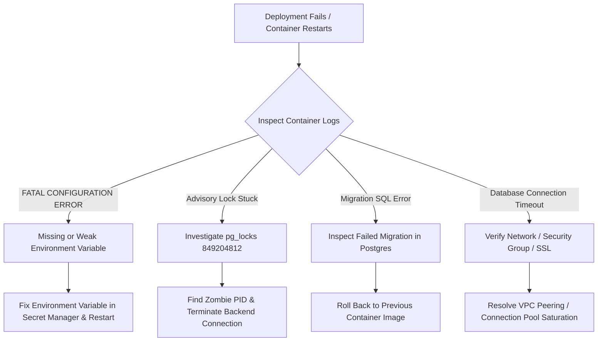

# Mathsy Meet — Production Recovery, Rollback & Deployment Runbook

**Document Version:** 1.0.0  
**Phase:** Phase 7 Checkpoint 2 (Operational Hardening)  
**Target Architecture:** Multi-Tenant SaaS Control-Plane (`dist-server/index.js`) + Mediasoup SFU (`rtc.mathsy.in`) + PostgreSQL (`schema_migrations`) + MongoDB (Chat/Session cache)  
**Safety Notice:** *This document is a local operational specification and runbook. Do not perform actual production deployments, secret rotations, or remote database operations without authorized change management approval.*

---

## Table of Contents

1. [Pre-Deployment Database Backup](#1-pre-deployment-database-backup)
2. [Database Migration Sequencing & Advisory Lock Verification](#2-database-migration-sequencing--advisory-lock-verification)
3. [Rollback Limitations: Additive vs Destructive Schema Changes](#3-rollback-limitations-additive-vs-destructive-schema-changes)
4. [Webhook Secret Rotation & AES-256-GCM Re-Encryption](#4-webhook-secret-rotation--aes-256-gcm-re-encryption)
5. [Production Secret Generation, Injection & Storage](#5-production-secret-generation-injection--storage)
6. [Coordinated Participant JWT Secret Alignment with SFU](#6-coordinated-participant-jwt-secret-alignment-with-sfu)
7. [Health Probes, Readiness Checks & Post-Deployment Monitoring](#7-health-probes-readiness-checks--post-deployment-monitoring)
8. [Safe Recovery Procedure (If Backend Fails to Start)](#8-safe-recovery-procedure-if-backend-fails-to-start)

---

## 1. Pre-Deployment Database Backup

Before applying any migration or deploying a new backend release, an authoritative backup of both PostgreSQL (metadata, tenant settings, billing, room logs) and MongoDB (chat logs, volatile session records) must be taken and verified.

### 1.1 PostgreSQL Backup Procedure

Execute from a secure bastion or CI runner with network access to PostgreSQL:

```bash
# Set timestamp and backup file path
BACKUP_TIMESTAMP=$(date +%Y%m%d_%H%M%S)
BACKUP_FILE="mathsy_meet_prod_predeploy_${BACKUP_TIMESTAMP}.dump"

# Take binary custom-format dump (supports parallel restore and selective table recovery)
pg_dump \
  --dbname="${DATABASE_URL}" \
  --format=custom \
  --blobs \
  --verbose \
  --file="${BACKUP_FILE}"

# Verify dump file is non-empty and valid
pg_restore --list "${BACKUP_FILE}" > /dev/null
echo "PostgreSQL backup successfully verified: ${BACKUP_FILE} ($(du -h ${BACKUP_FILE} | cut -f1))"
```

### 1.2 MongoDB Backup Procedure (Chat & Volatile Sessions)

```bash
MONGO_BACKUP_DIR="mongo_dump_predeploy_${BACKUP_TIMESTAMP}"

mongodump \
  --uri="${MONGODB_URI}" \
  --out="${MONGO_BACKUP_DIR}" \
  --gzip

echo "MongoDB backup completed at: ${MONGO_BACKUP_DIR}"
```

### 1.3 Pre-Flight Backup Verification Checklist

- [ ] Dump file size matches expected baseline (> 0 bytes).
- [ ] `pg_restore --list` displays all core tables: `users`, `organizations`, `customer_apps`, `api_keys`, `live_classes`, `room_participants`, `organization_usage_ledger`, `schema_migrations`.
- [ ] Backup artifact is replicated to offsite cold storage (e.g., S3/GCS with immutable object lock).

---

## 2. Database Migration Sequencing & Advisory Lock Verification

### 2.1 The Migration Engine

Mathsy Meet uses a transaction-safe, advisory-locked migration runner implemented in `server/db/index.ts` and tracked in the `schema_migrations` table:

```sql
CREATE TABLE IF NOT EXISTS schema_migrations (
    id SERIAL PRIMARY KEY,
    name VARCHAR(255) NOT NULL UNIQUE,
    checksum VARCHAR(64) NOT NULL,
    executed_at TIMESTAMPTZ NOT NULL DEFAULT NOW(),
    execution_time_ms INTEGER NOT NULL DEFAULT 0
);
```

### 2.2 Concurrency Safety (PostgreSQL Advisory Lock)

When multiple instances of `dist-server/index.js` boot simultaneously (e.g., in a Kubernetes rolling deployment or multi-container autoscaling group):
1. Instance requests a session advisory lock via `SELECT pg_advisory_lock(849204812);`.
2. All competing instances block until the leader completes or releases the lock.
3. The leader scans `server/db/migrations/*.sql` sorted alphanumerically.
4. For each file:
   - Computes SHA-256 checksum.
   - Queries `schema_migrations` by filename.
   - If recorded: skips execution immediately.
   - If unrecorded: executes migration inside an isolated `BEGIN ... COMMIT` transaction.
   - Inserts record into `schema_migrations` **only after the migration transaction succeeds**.
5. Once complete, releases lock via `SELECT pg_advisory_unlock(849204812);`.

### 2.3 Verification Commands

To check the migration state without altering database state:

```sql
-- List all applied migrations and their execution history
SELECT name, checksum, executed_at, execution_time_ms 
FROM schema_migrations 
ORDER BY id ASC;

-- Check if any transaction is currently holding the advisory lock
SELECT pid, mode, granted 
FROM pg_locks 
WHERE locktype = 'advisory' AND objid = 849204812;
```

### 2.4 Safe Migration Adoption Procedure for Existing Databases

When deploying Mathsy Meet with `schema_migrations` to a pre-existing database where some or all baseline migrations (`001`–`005`) were already applied manually, **blind pre-adoption with placeholder checksums (e.g. `'pre_adopted'`) is strictly prohibited**. Mathsy Meet's migration runner strictly validates that the on-disk file checksum matches the recorded checksum; placeholder strings will trigger checksum mismatch errors on startup.

#### Step 1: Verify Schema State Manually
Before recording any migration, verify that its structural and data effects are genuinely present:

```sql
-- Verify 001_secure_auth.sql effects:
SELECT indexname FROM pg_indexes WHERE indexname = 'idx_users_provider_unique';

-- Verify 002_multi_tenant_foundation.sql effects:
SELECT 1 FROM information_schema.tables WHERE table_name = 'organizations';
SELECT 1 FROM information_schema.columns WHERE table_name = 'live_classes' AND column_name = 'organization_id';
SELECT id, slug FROM organizations WHERE id = '00000000-0000-0000-0000-000000000001';

-- Verify 003_api_key_audit_logs.sql effects:
SELECT 1 FROM information_schema.tables WHERE table_name = 'api_key_audit_logs';

-- Verify 004_saas_operations.sql effects:
SELECT 1 FROM information_schema.tables WHERE table_name = 'webhook_endpoints';
SELECT 1 FROM information_schema.tables WHERE table_name = 'organization_usage_ledger';

-- Verify 005_webhook_secret_encryption.sql effects:
SELECT 1 FROM information_schema.columns WHERE table_name = 'webhook_endpoints' AND column_name = 'encrypted_secret';
```

#### Step 2: Compute Exact SHA-256 Checksums
Compute the actual cryptographic checksum for each verified migration file:

```bash
# In the build or deployment environment:
node -e '
const fs = require("fs");
const crypto = require("crypto");
["001_secure_auth.sql", "002_multi_tenant_foundation.sql", "003_api_key_audit_logs.sql", "004_saas_operations.sql", "005_webhook_secret_encryption.sql"].forEach(f => {
  const content = fs.readFileSync("dist-server/db/migrations/" + f, "utf-8");
  const hash = crypto.createHash("sha256").update(content).digest("hex");
  console.log(`INSERT INTO schema_migrations (name, checksum, execution_time_ms) VALUES ('${f}', '${hash}', 0) ON CONFLICT (name) DO NOTHING;`);
});
'
```

#### Step 3: Record Verified Migrations Under Advisory Lock
Execute the generated statements in a single transaction under advisory lock `849204812`:

```sql
BEGIN;
SELECT pg_advisory_lock(849204812);

CREATE TABLE IF NOT EXISTS schema_migrations (
    id SERIAL PRIMARY KEY,
    name VARCHAR(255) NOT NULL UNIQUE,
    checksum VARCHAR(64) NOT NULL,
    executed_at TIMESTAMPTZ NOT NULL DEFAULT NOW(),
    execution_time_ms INTEGER NOT NULL DEFAULT 0
);

-- Insert only verified migrations with exact computed SHA-256 hashes:
-- (Paste output from Step 2)

SELECT pg_advisory_unlock(849204812);
COMMIT;
```

If any migration's schema changes cannot be definitively confirmed, **do not record it**. Let the migration runner evaluate it inside its transaction during first boot, or perform an isolated dry-run in staging.

---

## 3. Rollback Limitations: Additive vs Destructive Schema Changes

### 3.1 Strict Additive Migration Rule

All production schema changes in Mathsy Meet adhere to the **Expand and Contract** pattern:
- **Phase A (Expand):** Add new columns as `NULL` or with `DEFAULT` values. Add new tables and additive indexes with `CONCURRENTLY`.
- **Phase B (Transition):** Dual-write or update application code to populate new columns while reading from old or fallback columns.
- **Phase C (Contract - Deferred):** Drop deprecated columns or remove legacy tables only after all client versions, SDK consumers, and services are fully transitioned.

### 3.2 Rollback Limitations

1. **Additive Changes (Safe Rollback):**
   - Adding tables (`webhook_endpoints`, `organization_usage_ledger`, `schema_migrations`) or additive nullable columns does **not** break older application code if the application is rolled back.
   - Older application versions simply ignore additional columns.
2. **Destructive Changes (Unsafe / Blocked):**
   - Dropping columns (`ALTER TABLE ... DROP COLUMN`) or renaming columns is **strictly forbidden** in normal zero-downtime releases.
   - Adding `NOT NULL` constraints without a default to existing tables locks the table and prevents rollbacks of prior code.
3. **If Migration Fails Mid-Step:**
   - Because each migration file runs inside its own `BEGIN ... COMMIT` transaction, any syntax or constraint failure triggers an immediate automatic rollback of that file's statements.
   - The file is **not** written to `schema_migrations`, allowing the engineer to deploy a fix without manual cleanup of half-applied DDL.

---

## 4. Webhook Secret Rotation & AES-256-GCM Re-Encryption

### 4.1 Encryption Architecture

- Webhook signing secrets are stored in the database column `webhook_endpoints.encrypted_secret`.
- Encryption standard: **AES-256-GCM** with a random 12-byte initialization vector (IV) per record.
- The encryption key is sourced from `process.env.WEBHOOK_ENCRYPTION_KEY` (must be 32 bytes / 64 hex characters).

### 4.2 Key Rotation Procedure

When `WEBHOOK_ENCRYPTION_KEY` must be rotated (e.g., quarterly compliance or incident response):

1. **Step 1 — Prepare New Key:**
   - Generate `NEW_KEY` (32 bytes).
   - Retain `CURRENT_KEY`.
2. **Step 2 — Run Re-Encryption Tool (Maintenance Window or Offline Script):**
   - Read all rows from `webhook_endpoints`.
   - Decrypt `encrypted_secret` using `CURRENT_KEY` (AES-256-GCM).
   - Re-encrypt using `NEW_KEY` with a freshly generated IV.
   - Update `webhook_endpoints` atomically in PostgreSQL.
3. **Step 3 — Deploy Updated Environment:**
   - Update `WEBHOOK_ENCRYPTION_KEY` in production secrets manager.
   - Restart backend control plane.
   - Verify health probe `/api/health/ready` returns HTTP 200.

---

## 5. Production Secret Generation, Injection & Storage

### 5.1 Required Environment Variables

| Variable Name | Required | Minimum Entropy | Description |
|---|---|---|---|
| `NODE_ENV` | Yes | N/A | Must be set to `production` |
| `PORT` | Yes | N/A | Control-plane listening port (e.g. `5001`) |
| `DATABASE_URL` | Yes | High | PostgreSQL connection URI with credentials and SSL mode (`sslmode=require`) |
| `MONGODB_URI` | Yes | High | MongoDB connection URI for volatile chat and session state |
| `JWT_SECRET` | Yes | ≥ 32 chars | Secret for signing control-plane user access/refresh tokens |
| `PARTICIPANT_JWT_SECRET` | Yes | ≥ 32 chars | **Shared Secret:** Must exactly match Mediasoup SFU participant token secret |
| `WEBHOOK_ENCRYPTION_KEY` | Yes | Exactly 32 bytes (64 hex) | AES-256-GCM key used to encrypt customer webhook endpoint secrets |
| `CORS_ORIGIN` | Yes | Valid URI list | Comma-delimited list of authorized origins (e.g. `https://meet.mathsy.in,https://app.mathsy.in`) |

### 5.2 Safe Secret Generation Commands

Run locally in a clean, non-logged shell (never commit output to git):

```bash
# Generate high-entropy 32-byte JWT Secret
JWT_SECRET=$(openssl rand -hex 32)

# Generate high-entropy 32-byte Participant JWT Secret (Must match SFU)
PARTICIPANT_JWT_SECRET=$(openssl rand -hex 32)

# Generate 32-byte AES-256-GCM Webhook Encryption Key (64 hex characters)
WEBHOOK_ENCRYPTION_KEY=$(openssl rand -hex 32)
```

### 5.3 Storage & Secret Management Rules

- **Never** store secrets in code repositories, Docker images, `.env` files checked into git, or CI logs.
- Inject secrets via an authorized cloud secret provider:
  - AWS Secrets Manager / Parameter Store (KMS-encrypted)
  - HashiCorp Vault
  - Google Cloud Secret Manager
  - Kubernetes SealedSecrets / External-Secrets Operator

---

## 6. Coordinated Participant JWT Secret Alignment with SFU

### 6.1 The SFU Coupling Risk

The control plane generates short-lived participant tokens signed with `PARTICIPANT_JWT_SECRET`:
```typescript
jwt.sign(claims, PARTICIPANT_JWT_SECRET, { algorithm: "HS256" })
```
When participants connect to the Mediasoup SFU (`https://rtc.mathsy.in`) over Socket.IO, the SFU validates the token signature using its local environment variable `PARTICIPANT_JWT_SECRET`.

> [!CAUTION]
> If `PARTICIPANT_JWT_SECRET` is changed on the control plane without simultaneously updating the Mediasoup SFU, all newly issued participant tokens will fail signature verification on the SFU with `401 Unauthorized / INVALID_TOKEN`, immediately breaking classroom audio and video.

### 6.2 Zero-Downtime Rotation Protocol

To rotate `PARTICIPANT_JWT_SECRET` without dropping active classrooms:
1. **Option A (Scheduled Off-Peak Window):**
   - Schedule during low-traffic window.
   - Update `PARTICIPANT_JWT_SECRET` on Mediasoup SFU first or simultaneously with control plane.
   - Existing active WebRTC transport sockets remain established; reconnecting users obtain freshly signed tokens.
2. **Option B (Dual-Secret SFU Validation — Recommended for High-Availability):**
   - Configure SFU with `PARTICIPANT_JWT_SECRET` (primary) and `PARTICIPANT_JWT_SECRET_PREVIOUS` (fallback verifier).
   - Deploy SFU with new key as secondary.
   - Deploy control plane with new key as primary.
   - Verify all joins succeed.
   - Decommission old key from SFU secondary verifier.

---

## 7. Health Probes, Readiness Checks & Post-Deployment Monitoring

### 7.1 Automated Endpoints

The control plane exposes structured health and readiness endpoints for load balancers and orchestrators:

| Endpoint | HTTP Status | Purpose | Validation Checked |
|---|---|---|---|
| `GET /api/health/live` | `200 OK` | Liveness Probe | Event loop responsiveness, process memory usage |
| `GET /api/health/ready` | `200 OK` / `503 Service Unavailable` | Readiness Probe | Active PostgreSQL connectivity (`SELECT 1`), MongoDB read/write |
| `GET /api/health` | `200 OK` / `503 Service Unavailable` | Comprehensive Diagnostics | Database status, Redis/Cache status, external SFU reachability |

### 7.2 Post-Deployment Validation Checklist

Immediately after deployment traffic switchover:

1. **Check Liveness & Readiness:**
   ```bash
   curl -s -o /dev/null -w "%{http_code}\n" https://meet.mathsy.in/api/health/live
   # Expect: 200

   curl -s -o /dev/null -w "%{http_code}\n" https://meet.mathsy.in/api/health/ready
   # Expect: 200
   ```
2. **Inspect Migration Table:**
   Confirm that all expected migrations are recorded:
   ```sql
   SELECT name, executed_at FROM schema_migrations ORDER BY id DESC LIMIT 5;
   ```
3. **Verify Abandoned Room Reconciliation Log:**
   Ensure the periodic reaper is running every 5 minutes without uncaught exceptions:
   ```
   {"level":"info","message":"Abandoned room reconciliation completed","sweptRooms":0,"reconciledSessions":0}
   ```
4. **Monitor Error Rates:**
   Inspect Datadog / CloudWatch / Prometheus for:
   - HTTP 500 error spikes on `/api/v1/rooms` or `/api/v1/tokens`.
   - Webhook delivery failures in `webhook_deliveries` table.
   - PostgreSQL connection pool saturation (`pool.waitingCount > 0`).

---

## 8. Safe Recovery Procedure (If Backend Fails to Start)

If a newly deployed backend container crashes during boot or fails the `/api/health/ready` probe, execute the following emergency triage:



### 8.1 Troubleshooting Step-by-Step

#### Scenario 1: Fatal Startup Validation Error
- **Symptom:** Log displays `🚨 FATAL CONFIGURATION ERROR: STARTUP VALIDATION FAILED`.
- **Cause:** An environment variable (`JWT_SECRET`, `PARTICIPANT_JWT_SECRET`, `DATABASE_URL`, `WEBHOOK_ENCRYPTION_KEY`) is missing, less than 32 characters, or using a known insecure development default.
- **Action:** Update the secret value in the cloud secret manager. The backend intentionally refuses to start to protect production against token forgery.

#### Scenario 2: Stuck PostgreSQL Advisory Lock
- **Symptom:** Backend hangs indefinitely during boot before logging listening port.
- **Diagnosis:**
  ```sql
  SELECT pid, query_start, state, query 
  FROM pg_stat_activity 
  WHERE pid IN (
    SELECT pid FROM pg_locks WHERE locktype = 'advisory' AND objid = 849204812
  );
  ```
- **Action:** If the holding PID belongs to a terminated/zombie container:
  ```sql
  SELECT pg_terminate_backend(<holding_pid>);
  ```

#### Scenario 3: Container Rollback
If the application code exhibits a critical regression:
1. Re-route load balancer traffic to the previous healthy container image tag.
2. Because all database migrations are strictly additive, older containers can safely run against the current database schema without requiring a destructive schema rollback.
3. If database restoration from backup is strictly required:
   ```bash
   # Terminate active connections
   psql "${DATABASE_URL}" -c "SELECT pg_terminate_backend(pid) FROM pg_stat_activity WHERE datname = 'mathsy_meet' AND pid <> pg_backend_pid();"
   
   # Restore clean pre-deployment dump
   pg_restore --clean --if-exists --dbname="${DATABASE_URL}" "${BACKUP_FILE}"
   ```
