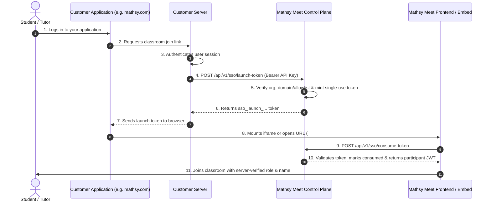

# Mathsy Meet — Organization Single Sign-On (SSO) Integration Guide

This guide describes how to integrate Mathsy Meet into a third-party application (e.g., Mathsy, LMS, University Portal, or custom CRM) using **Organization Single Sign-On (SSO)** and **Server-to-Server Launch Tokens**.

---

## 1. Overview & Security Architecture

Mathsy Meet enforces zero-trust identity verification:



### Key Security Guarantees:
- **No Browser API Keys:** Private API keys (`sec_live_...`) remain exclusively on your backend.
- **Single-Use Launch Tokens:** Launch tokens are consumable only once. Replaying a token returns `401 TOKEN_ALREADY_USED`.
- **Short-Lived:** Launch tokens expire within 5 minutes (configurable up to 15 minutes).
- **URL Secret Scrubbing:** When opened in a browser or iframe, the `#sso_token=...` hash is immediately scrubbed from browser history and `Referer` headers using `history.replaceState`.
- **Stable Identity Mapping:** Users are mapped to `organization_id + external_issuer + external_subject`.
- **Role Escalation Protection:** If a user is registered as a student in Mathsy Meet, they cannot request a tutor token.

---

## 2. Organization SSO Configuration

In the **Developer Console** (`/dashboard`):

1. **Enable SSO:** Toggle the **SSO Master Switch** to `ON`.
2. **Configure Access Rules:**
   - **Automatic Domain Provisioning:** Add your domain (e.g. `mathsy.com` or `school.edu`) to the **Verified Email Domains** list. Any user with a matching email address will be automatically provisioned on first launch.
   - **Manual Allowlist:** If you prefer strict approval, add individual users under **Provisioned Users & Allowlist**.
3. **Set Default Role:** Select whether auto-provisioned users join as `student` or `tutor`.

---

## 3. Backend Integration (Node.js / Express)

Install `@mathsy/meet-sdk`:

```bash
npm install @mathsy/meet-sdk
```

Generate the single-use launch token on your server:

```typescript
import express from "express";
import { MathsyMeetServerClient } from "@mathsy/meet-sdk/server";

const app = express();
app.use(express.json());

// Initialize client with secret API key from Mathsy Meet Developer Console
const mathsyClient = new MathsyMeetServerClient({
  apiKey: process.env.MATHSY_MEET_API_KEY!, // sec_live_...
  apiBaseUrl: process.env.MATHSY_MEET_API_URL || "https://152-67-5-129.sslip.io/api/v1",
});

// Endpoint for your authenticated users to join a meeting
app.post("/api/meet/launch", async (req, res) => {
  try {
    // 1. Authenticate user from your own session or JWT
    const currentUser = req.session?.user; // Example: { id: "u_9421", email: "student@mathsy.com", name: "Rohan Patel", role: "student" }
    if (!currentUser) {
      return res.status(401).json({ error: "Unauthorized" });
    }

    const { roomCode } = req.body;
    if (!roomCode) {
      return res.status(400).json({ error: "roomCode is required" });
    }

    // 2. Mint single-use SSO launch token
    const ssoData = await mathsyClient.generateSsoLaunchToken({
      roomCode,
      email: currentUser.email,
      name: currentUser.name,
      role: currentUser.role === "tutor" ? "tutor" : "student",
      externalIssuer: "mathsy-portal",
      externalSubject: currentUser.id,
      expiresInSeconds: 300, // 5 minutes
    });

    // 3. Return the launch token to your frontend
    return res.json({
      roomCode,
      ssoToken: ssoData.launchToken,
      embedUrl: ssoData.embedUrl,
      roomUrl: ssoData.roomUrl,
    });
  } catch (err: any) {
    console.error("SSO generation error:", err.message);
    return res.status(500).json({ error: err.message || "Failed to generate SSO launch token" });
  }
});
```

---

## 4. Frontend Integration

### Option A: React Component (`@mathsy/meet-sdk/react`)

```tsx
import React, { useEffect, useState } from "react";
import { MathsyMeeting } from "@mathsy/meet-sdk/react";

export function LiveClassroom({ roomCode }: { roomCode: string }) {
  const [ssoToken, setSsoToken] = useState<string | null>(null);
  const [error, setError] = useState<string | null>(null);

  useEffect(() => {
    // Fetch short-lived launch token from your backend
    fetch("/api/meet/launch", {
      method: "POST",
      headers: { "Content-Type": "application/json" },
      body: JSON.stringify({ roomCode }),
    })
      .then((res) => res.json())
      .then((data) => {
        if (data.error) setError(data.error);
        else setSsoToken(data.ssoToken);
      })
      .catch((err) => setError(err.message));
  }, [roomCode]);

  if (error) return <div className="p-4 text-red-500">Error: {error}</div>;
  if (!ssoToken) return <div className="p-4 text-gray-400">Loading meeting room...</div>;

  return (
    <div className="w-full h-[750px] rounded-xl overflow-hidden border border-gray-800">
      <MathsyMeeting
        roomCode={roomCode}
        ssoToken={ssoToken}
        embedBaseUrl="https://classroom-meet.vercel.app"
        width="100%"
        height="100%"
        onJoined={(participant) => console.log("Joined class as:", participant.name)}
        onError={(err) => console.error("Classroom error:", err)}
      />
    </div>
  );
}
```

### Option B: Plain HTML / Iframe

```html
<iframe
  id="mathsy-frame"
  src="https://classroom-meet.vercel.app/embed/math-101#sso_token=sso_launch_abc123"
  allow="camera; microphone; display-capture; autoplay; clipboard-write"
  style="width: 100%; height: 700px; border: none; border-radius: 12px;"
></iframe>
```

### Option C: Direct New Tab Launch

```javascript
window.open(`https://classroom-meet.vercel.app/meet/${roomCode}#sso_token=${launchToken}`, "_blank");
```

---

## 5. Error Codes & Troubleshooting

| Error Code | HTTP Status | Description | Action |
| :--- | :--- | :--- | :--- |
| `SSO_DISABLED` | 403 | SSO is turned off for this organization. | Enable SSO in the Developer Console. |
| `SSO_USER_UNAUTHORIZED` | 403 | User email is not in allowlist and domain is unverified. | Add domain to Verified Domains or add email to Allowlist. |
| `SSO_USER_REVOKED` | 403 | User was revoked by organization administrator. | Reactivate user in Developer Console. |
| `SSO_ROLE_ESCALATION` | 403 | User is registered as student but attempted tutor launch. | Request appropriate role. |
| `TOKEN_EXPIRED` | 401 | Launch token expired before being consumed. | Request a new launch token from your backend. |
| `TOKEN_ALREADY_USED` | 401 | Launch token was already consumed (replay attack). | Tokens are single-use; request a fresh token on page refresh. |
| `ORIGIN_NOT_ALLOWED` | 403 | Parent origin not registered in Allowed Domains. | Add your parent domain to Allowed Domains in Developer Console. |
