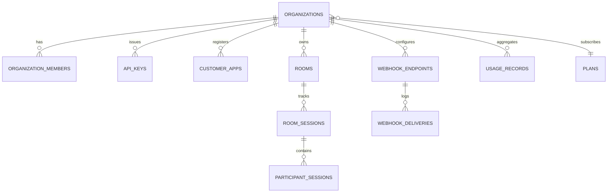

# Mathsy Meet SaaS — Multi-Tenant Schema & Isolation Strategy

**Document:** `docs/saas/tenant-isolation.md`  
**Date:** October 2026  
**Status:** Database Architecture Specification

---

## 1. Schema Extension Design (Smallest Safe Extension)

To transform Mathsy Meet into a commercial multi-tenant SaaS without breaking existing classroom functionality, we design a minimal, additive PostgreSQL schema. No existing tables will be renamed or dropped.



---

## 2. Table-by-Table Schema Specification

### 1. `organizations` (Tenants)
- **Purpose:** Represents an independent commercial business customer.
- **Primary Key:** `id` UUID (`uuid_generate_v4()`).
- **Columns:**
  - `name`: VARCHAR(255) NOT NULL
  - `slug`: VARCHAR(100) NOT NULL UNIQUE (e.g. `acme-academy`)
  - `plan_id`: VARCHAR(50) NOT NULL DEFAULT 'starter' REFERENCES `plans(id)`
  - `status`: VARCHAR(20) NOT NULL DEFAULT 'active' CHECK (status IN ('active', 'suspended', 'delinquent'))
  - `settings`: JSONB NOT NULL DEFAULT '{"max_room_duration_min": 240, "default_camera_locked": true}'::jsonb
  - `created_at`, `updated_at`: TIMESTAMPTZ NOT NULL DEFAULT NOW()
- **Indexes:** `idx_organizations_slug` (UNIQUE), `idx_organizations_status`.

### 2. `organization_members`
- **Purpose:** Portal dashboard user memberships within an organization.
- **Primary Key:** `id` UUID.
- **Columns:**
  - `organization_id`: UUID NOT NULL REFERENCES `organizations(id)` ON DELETE CASCADE
  - `user_id`: UUID NOT NULL REFERENCES `users(id)` ON DELETE CASCADE
  - `role`: VARCHAR(30) NOT NULL CHECK (role IN ('owner', 'admin', 'developer', 'viewer'))
  - `created_at`: TIMESTAMPTZ NOT NULL DEFAULT NOW()
- **Indexes:** `UNIQUE(organization_id, user_id)`, `idx_org_members_user`.

### 3. `api_keys`
- **Purpose:** Machine-to-machine authentication credentials for customer backends.
- **Primary Key:** `id` UUID.
- **Columns:**
  - `organization_id`: UUID NOT NULL REFERENCES `organizations(id)` ON DELETE CASCADE
  - `name`: VARCHAR(100) NOT NULL (e.g. "Production LMS Server")
  - `key_prefix`: VARCHAR(16) NOT NULL (e.g. `sec_live_9xK2`)
  - `key_hash`: TEXT NOT NULL UNIQUE (Argon2id or SHA-256 hash of full secret)
  - `environment`: VARCHAR(10) NOT NULL DEFAULT 'live' CHECK (environment IN ('live', 'test'))
  - `is_active`: BOOLEAN NOT NULL DEFAULT TRUE
  - `last_used_at`: TIMESTAMPTZ
  - `expires_at`: TIMESTAMPTZ
  - `created_at`: TIMESTAMPTZ NOT NULL DEFAULT NOW()
- **Indexes:** `idx_api_keys_hash` (UNIQUE), `idx_api_keys_org`.

### 4. `customer_apps`
- **Purpose:** Embed whitelisting and application profiles for third-party websites.
- **Primary Key:** `id` UUID.
- **Columns:**
  - `organization_id`: UUID NOT NULL REFERENCES `organizations(id)` ON DELETE CASCADE
  - `app_name`: VARCHAR(100) NOT NULL
  - `allowed_domains`: TEXT[] NOT NULL DEFAULT '{}' (e.g. `{"https://lms.acme.edu", "https://portal.acme.edu"}`)
  - `branding`: JSONB NOT NULL DEFAULT '{"logo_url": null, "primary_color": "#4f46e5"}'::jsonb
  - `created_at`: TIMESTAMPTZ NOT NULL DEFAULT NOW()
- **Indexes:** `idx_customer_apps_org`.

### 5. `rooms` (Replaces/Extends `live_classes`)
- **Purpose:** Tenant-scoped meeting rooms.
- **Primary Key:** `id` UUID.
- **Columns:**
  - `organization_id`: UUID NOT NULL REFERENCES `organizations(id)` ON DELETE CASCADE
  - `room_code`: VARCHAR(64) NOT NULL UNIQUE
  - `title`: VARCHAR(255) NOT NULL
  - `is_active`: BOOLEAN NOT NULL DEFAULT TRUE
  - `features`: JSONB NOT NULL DEFAULT '{"whiteboard": true, "polls": true, "chat": true, "screenshare": true, "record": false}'::jsonb
  - `max_participants`: INT NOT NULL DEFAULT 100
  - `created_at`, `ended_at`: TIMESTAMPTZ
- **Indexes:** `UNIQUE(room_code)`, `idx_rooms_org_active (organization_id, is_active)`.

### 6. `room_sessions`
- **Purpose:** Discrete execution instances of a meeting room.
- **Primary Key:** `id` UUID.
- **Columns:**
  - `room_id`: UUID NOT NULL REFERENCES `rooms(id)` ON DELETE CASCADE
  - `organization_id`: UUID NOT NULL REFERENCES `organizations(id)` ON DELETE CASCADE
  - `session_id`: VARCHAR(64) NOT NULL UNIQUE
  - `started_at`: TIMESTAMPTZ NOT NULL DEFAULT NOW()
  - `ended_at`: TIMESTAMPTZ
  - `peak_participants`: INT NOT NULL DEFAULT 0
  - `total_participant_minutes`: INT NOT NULL DEFAULT 0
- **Indexes:** `idx_room_sessions_org`, `idx_room_sessions_session_id`.

### 7. `participant_sessions`
- **Purpose:** Granular participant attendance, connection duration, and metering log.
- **Primary Key:** `id` UUID.
- **Columns:**
  - `session_id`: VARCHAR(64) NOT NULL
  - `organization_id`: UUID NOT NULL REFERENCES `organizations(id)` ON DELETE CASCADE
  - `room_code`: VARCHAR(64) NOT NULL
  - `user_id`: VARCHAR(255) NOT NULL (External customer user ID)
  - `display_name`: VARCHAR(255) NOT NULL
  - `role`: VARCHAR(20) NOT NULL CHECK (role IN ('host', 'tutor', 'student', 'viewer'))
  - `joined_at`: TIMESTAMPTZ NOT NULL DEFAULT NOW()
  - `left_at`: TIMESTAMPTZ
  - `duration_seconds`: INT DEFAULT 0
- **Indexes:** `idx_part_sessions_org_dates (organization_id, joined_at)`, `idx_part_sessions_session (session_id, user_id)`.

### 8. `usage_records`
- **Purpose:** Aggregated monthly billing and quota consumption.
- **Primary Key:** `id` UUID.
- **Columns:**
  - `organization_id`: UUID NOT NULL REFERENCES `organizations(id)` ON DELETE CASCADE
  - `billing_period`: VARCHAR(7) NOT NULL (e.g. `2026-10`)
  - `total_participant_minutes`: BIGINT NOT NULL DEFAULT 0
  - `total_rooms_hosted`: INT NOT NULL DEFAULT 0
  - `peak_concurrent_participants`: INT NOT NULL DEFAULT 0
  - `updated_at`: TIMESTAMPTZ NOT NULL DEFAULT NOW(),
  - `UNIQUE(organization_id, billing_period)`
- **Indexes:** `idx_usage_records_org_period`.

### 9. `webhook_endpoints` & `webhook_deliveries`
- **Purpose:** Outbound event notifications to customer servers.
- **Endpoints Columns:** `id`, `organization_id`, `url`, `secret` (for HMAC-SHA256 signature), `events` (TEXT[]), `is_active`.
- **Deliveries Columns:** `id`, `endpoint_id`, `organization_id`, `event_type`, `payload` (JSONB), `status_code`, `response_time_ms`, `attempt_number`, `created_at`.

### 10. `plans`
- **Purpose:** Subscription tiers and hard limits.
- **Columns:**
  - `id`: VARCHAR(50) PRIMARY KEY (e.g. `starter`, `growth`, `enterprise`)
  - `name`: VARCHAR(100) NOT NULL
  - `included_participant_minutes`: BIGINT NOT NULL
  - `max_concurrent_participants`: INT NOT NULL
  - `max_room_capacity`: INT NOT NULL
  - `recording_enabled`: BOOLEAN NOT NULL DEFAULT FALSE

---

## 3. Data Isolation Strategy

1. **Logical Separation via Mandatory Tenant Filters:**
   - Every tenant-scoped database table contains a mandatory `organization_id UUID NOT NULL` column.
   - All backend SQL queries are parameterized with `organization_id`:
     ```sql
     SELECT * FROM rooms WHERE id = $1 AND organization_id = $2;
     ```
2. **PostgreSQL Row-Level Security (RLS) as Defense-in-Depth:**
   - For authenticated database connections, RLS policies enforce:
     ```sql
     ALTER TABLE rooms ENABLE ROW LEVEL SECURITY;
     CREATE POLICY tenant_isolation_policy ON rooms
     USING (organization_id = current_setting('app.current_tenant_id')::uuid);
     ```
3. **MongoDB Ephemeral Chat Isolation:**
   - In MongoDB, all `chat_messages` documents require `tenantId: organization_id`.
   - Index: `{ tenantId: 1, sessionId: 1, createdAt: 1 }`.
   - Querying messages without specifying `tenantId` is rejected by the query layer.

---

## 4. First-Party Backward Compatibility & Rollback

- **Default System Tenant:**
  - Organization ID: `00000000-0000-0000-0000-000000000000`
  - Name: `"Mathsy Classroom (First-Party)"`
  - Slug: `"default"`
  - Plan: `"enterprise"` (Unlimited quota)
- **Zero-Downtime Data Migration:**
  - Step 1: Insert default tenant into `organizations`.
  - Step 2: Add `organization_id UUID REFERENCES organizations(id)` column to `live_classes` with `DEFAULT '00000000-0000-0000-0000-000000000000'`.
  - Existing classroom links (`/meet/:roomCode`) continue querying without code modification.
- **Rollback Guarantee:**
  - If multi-tenant features must be rolled back, the new tables can be dropped and the `organization_id` foreign key removed without impacting legacy `live_classes` data.
